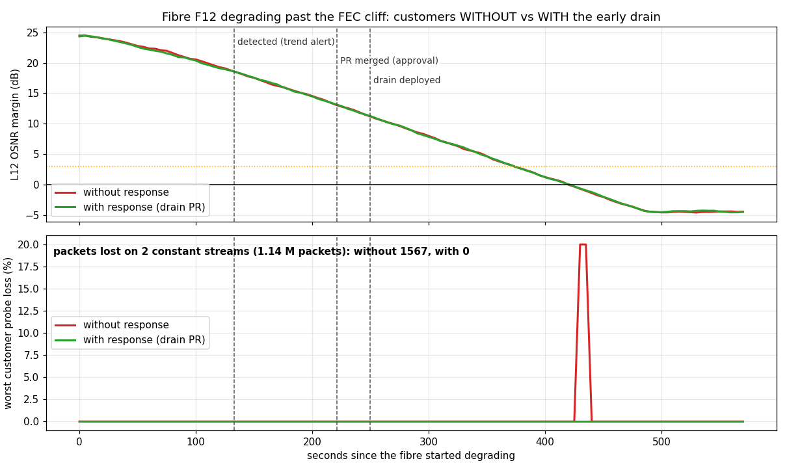
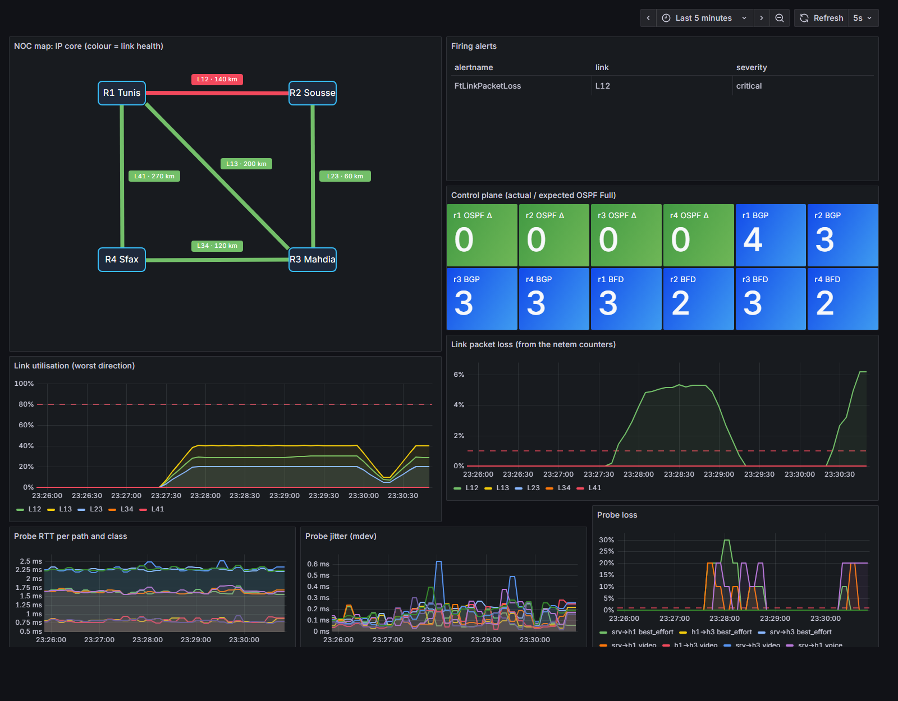
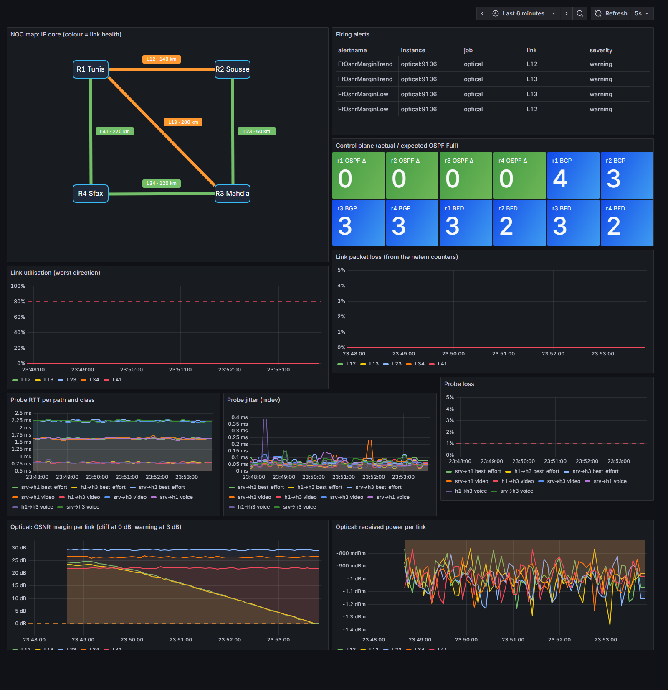
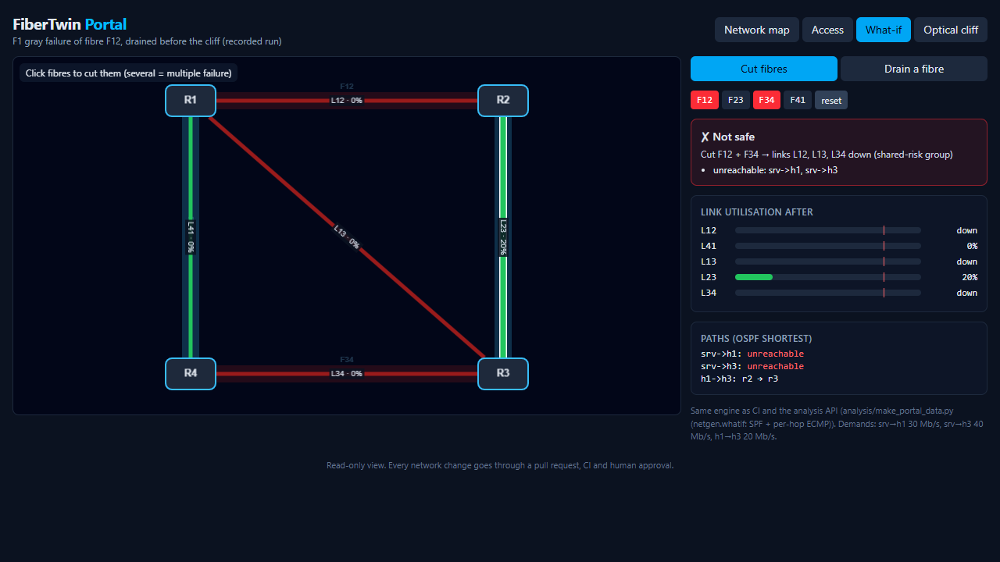
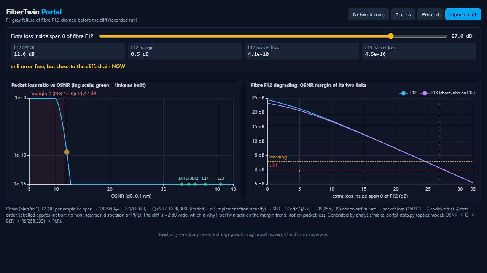

# FiberTwin-Ops

**An FTTx-inspired network operations twin that catches a degrading fibre before any packet is lost, names it, and drains it through a safety-checked, human-approved pull request.**

🇫🇷 [Version française plus bas](#-version-française) · ▶ **[Live portal (replay of a recorded incident)](https://azyzex.github.io/FiberTwin-Ops/)**

> **What is real and what is modelled.** The routers are **real FRR software** (OSPF, BGP, BFD) in containers, carrying real traffic. The OLT and ONTs are **Linux nodes**; the splitter is a **Linux bridge**. Optical power and OSNR are **modelled** with course-level formulas; their *effect* (packet loss, latency) is applied to the real links with `tc netem` and **measured by real probes**. Everything runs on one laptop (7.4 GB RAM) and in free GitHub CI.

## The headline result



Same fibre (F12) degrading past the FEC cliff, twice, with 1.14 M customer packets crossing it:

| | Without the response | **With FiberTwin** |
|---|---|---|
| Degradation detected (OSNR margin trend) | 130 s | 133 s |
| Drain pull request opened by the system | – | 133 s ([PR #10](https://github.com/azyzex/FiberTwin-Ops/pull/10)) |
| CI green → merged by a human | – | 221 s |
| Drain applied (pull-based GitOps, hitless) | – | 250 s |
| Fibre crosses the cliff | ~420 s | ~420 s |
| **Packets lost** | **1,567** | **0** |

A hard cut is different: OSPF + BFD reroute in **0.74–0.85 s** by themselves, so the system only opens a work order ([issue #12](https://github.com/azyzex/FiberTwin-Ops/issues/12)) and changes nothing. Each fault class gets the response a real operator could honestly give.

## How it works

```
 L0  optical layer (MODELLED)   fibres F12 F23 F34 F41 · WDM lightpaths (RWA) · OSNR per span → Q → BER → RS(255,239) → packet loss
        │ netem loss + fibre delay on the IP links that ride each fibre (shared-risk groups)
 L3  IP core (REAL FRR)          ring r1-r2-r3-r4 + chord · OSPF + BFD · iBGP full mesh · eBGP upstream · 100 Mbit/s links (1:1000)
        │
 ACC access (REAL nodes,         OLT → 1:32 splitter (Linux bridge) → 4 ONTs · GPON power budget per ONT and direction
     MODELLED optics)
```

```
 sot/network.yaml ─► PR ─► CI: validate · render (Nornir + Jinja2) · 97 unit tests · capacity + SRLG what-if · Batfish
     ▲                          └► temporary twin on the runner ─► 13 live tests ─► ✅ / ❌
     │                 merge (= human approval) ─► main (protected) ◄── pull-based deployer on the laptop (30 s)
     │                                                                    └► hitless frr-reload ─► live tests
     │  drain PR                                                            └► repairs drift (lost links, manual edits)
 analysis API (Python, decides) ◄── n8n playbook (orchestrates) ◄── Alertmanager ◄── Prometheus ◄── probes + optical telemetry
```

- **n8n orchestrates, Python decides, a human approves.** The analysis API ([`analysis/`](analysis)) correlates alerts to a fibre through shared-risk groups, runs the same what-if engine as CI, opens the PR, verifies recovery and opens a revert PR if customers did not recover. Its GitHub token is scoped to this repository only; it can propose a change, never merge it.
- **Guardrails:** only the gray-failure class may change the network; one change per element at a time; cooldown; the same CI as a human change; automatic revert if verification fails; every drain has a restore PR.

## Status (measured on the laptop and in CI)

| Slice | What | Key result | |
|---|---|---|---|
| [Step 0](step0) | laptop feasibility | FRR ~19 MiB/router; netem/htb/BTF work in WSL 2 | ✅ |
| [1a](labs/core-1a) | FRR core | port down 0.06 s · silent cut with BFD 0.74–0.85 s · without BFD 33–36 s | ✅ |
| 1b | GitOps | bad PR blocked in 16 s · merge → applied & verified in ~7 s, hitless | ✅ |
| [1c](monitoring) | monitoring + NOC map | injected loss visible in 8 s, map red, exactly 1 alert (symptoms inhibited) | ✅ |
| [1d](optics) | optical layer | model reproduces the plan's BER→loss table; trend alert 218 s before the first lost packet | ✅ |
| [1e](analysis) | incident response | 0 vs 1,567 packets lost (above) | ✅ |
| 1f | access network | degrading drop connector → **work order naming the drop of ONT3 at 127 s, 2 min before the ONT went dark**; other ONTs untouched; an early "repaired" report refused, the real one closed incident + issue ([data](results/1f-access-e2e.json)) | ✅ |
| 2 | NetDevOps depth | [15/15 bad changes](results/bad-changes.md) caught statically · Batfish models OSPF 10/10, iBGP 12/12 · out-of-band edits detected and reverted | 🟨 |
| 4 | QoS study | voice MOS (ITU-T G.107 E-model) per path | 🟨 |
| [Portal](portal) | React web app | replay, what-if simulator, optical cliff explorer, 22 browser tests | ✅ |

| NOC dashboard during an injected fault | Gray failure caught before any loss |
|---|---|
|  |  |
| **Portal: what-if (two fibres cut)** | **Portal: the optical cliff** |
|  |  |

## Run it
Requirements: Docker Engine, containerlab, Python 3.13 (Linux / WSL 2; ~1 GB RAM for the core + monitoring).
```bash
pip install -r requirements.txt
python -m netgen.render && sudo bash twin/deploy.sh          # the twin, from the source of truth
pytest -q tests && sudo pytest -q tests_live                 # 97 unit + 13 live tests
sudo FT_ROOT=$PWD bash monitoring/up.sh                      # Prometheus, Grafana :3000, optical agent, analysis API, n8n
```

## Limitations (stated, not hidden)
- The optics are first-order models (ASE-limited NRZ-OOK, no nonlinearities, dispersion or PMD; GPON TDMA/DBA not modelled), and the data come from my own models: validation on real equipment is future work.
- Degradations are time-compressed (dB per minute) so a demo fits in minutes; real fibres degrade over hours or days, and the trend thresholds must be tuned for that (Slice 4).
- One loss rate per link (size-independent); "approval" in the experiment was played immediately once CI was green.

## Folders
| | |
|---|---|
| `sot/` | source of truth: the only place the network is described |
| `netgen/` | Nornir + Jinja2 generator, validation, what-if engine, Batfish check |
| `twin/`, `deployer/` | deploy the twin; pull-based GitOps agent with drift repair |
| `optics/` | optical models (core OSNR chain, GPON budget) and the agent that applies them |
| `monitoring/` | exporter, Prometheus rules (+ promtool tests), Alertmanager, Grafana dashboard generator |
| `analysis/`, `n8n/` | incident API, n8n playbook, experiments, charts, replay export |
| `portal/`, `contracts/` | the web portal and the JSON data contract it reads |
| `tests/`, `tests_live/`, `results/` | unit tests, live tests, measured results |

---

## 🇫🇷 Version française

**Un jumeau numérique d'exploitation réseau d'inspiration FTTx qui détecte une fibre en dégradation avant toute perte de paquet, l'identifie et la contourne via une pull request vérifiée et approuvée par un humain.**

> **Ce qui est réel et ce qui est modélisé.** Les routeurs sont de **vrais FRR** (OSPF, BGP, BFD) en conteneurs, avec du vrai trafic. L'OLT et les ONT sont des **nœuds Linux**, le coupleur est un **bridge Linux**. La puissance optique et l'OSNR sont **modélisés** avec des formules de cours ; leur *effet* (pertes, latence) est appliqué aux vrais liens avec `tc netem` et **mesuré par de vraies sondes**. Le tout tourne sur un seul portable (7,4 Go de RAM) et dans la CI GitHub gratuite.

**Résultat principal.** Même fibre (F12) dégradée jusqu'à la falaise FEC, deux fois, avec 1,14 M de paquets clients : **1 567 paquets perdus sans la réponse, 0 avec FiberTwin**. Détection sur la tendance de la marge OSNR (133 s), pull request ouverte par le système (133 s), fusion par un humain après CI verte (221 s), application GitOps sans coupure (250 s), bien avant la falaise (~420 s). Une coupure franche est gérée par OSPF + BFD en moins d'une seconde : le système ouvre seulement un bon d'intervention, sans toucher à la configuration.

**Fonctionnement.** Source de vérité YAML → génération Nornir/Jinja2 → CI (tests unitaires, what-if de capacité et de groupes de risque partagé, Batfish, jumeau temporaire avec tests en direct) → fusion = approbation humaine → déploiement *pull* sur le portable, qui répare aussi la dérive. n8n orchestre, l'API Python décide, un humain approuve.

**Limites assumées.** Modèles optiques du premier ordre ; données issues de mes propres modèles (validation sur équipement réel à faire) ; dégradations accélérées pour la démonstration.
