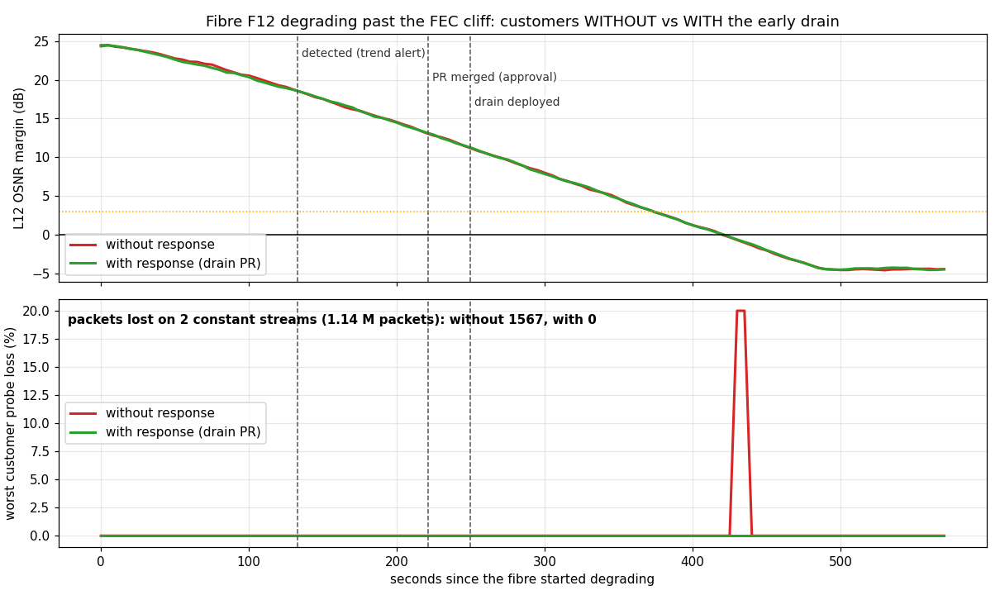
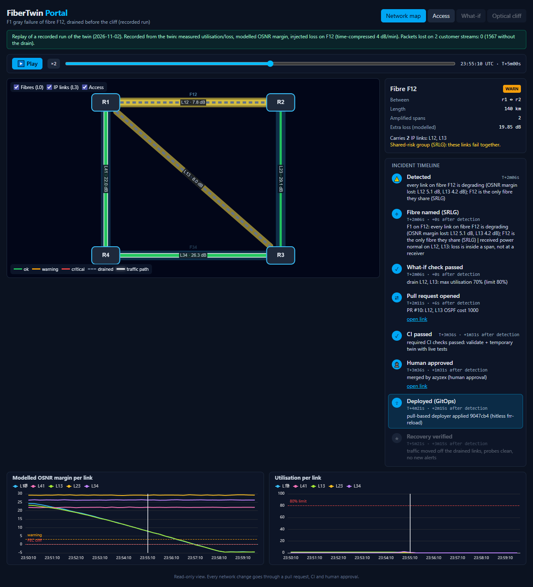

# Slice 1e: incident response, the golden path



**Same fibre failure, twice.** Fibre F12 degrades past the FEC cliff while two constant customer streams (1000 pkt/s each, 1.14 M packets in total) cross its two IP links.

| | Without the response | **With the response** |
|---|---|---|
| Trend alert (detection) | 130 s | 133 s |
| Drain PR opened | – | 133 s |
| CI green → merged (human approval) | – | 217 s → 221 s |
| Drain deployed (pull-based, hitless) | – | **250 s** |
| Modelled loss starts (FEC cliff) | 420 s | 418 s |
| **Packets lost** | **1,567** | **0** |

*Data: `results/1e-golden-path.json` (`analysis/experiment.py`). Time-compressed degradation (4 dB/min); approval played immediately once CI was green.*

Without the response, BFD and OSPF do reroute, but only *after* the link starts losing packets: ~0.8 s of traffic is lost per stream at the cliff. With the response, traffic left F12 **~170 s before** the cliff.

## Who decides, who orchestrates
```
Alertmanager ─webhook─► n8n playbook (n8n/workflows/golden-path.json, generated by make_workflow.py)
                          orchestrates: order of steps, 20 s polling, 60 s settle, 15 min escalation reminder
                          │ every decision and external action is a call to:
                          ▼
                 analysis API (FastAPI + SQLite, analysis/app.py; logic in analysis/logic.py, 13 tests)
                   /alerts     correlate: which fault class (F1 / F1b / F2), which fibre (SRLG)
                   /whatif     capacity + SRLG check: the same netgen.whatif engine CI uses
                   /drain-pr   GitHub PR: OSPF cost 10 → 1000 on every link of the fibre (SoT edit)
                   /ticket     GitHub issue (work order) for F1b / F2
                   /status     merged (= approval, main is protected so = CI green) → deployed (deployer's sha)
                   /verify     traffic off the drained links, customer probes clean, no new alerts → else revert PR
                   every step = an event (data contract) → Slack, Grafana annotations, portal replay
```
- GitHub access uses a **fine-grained token scoped to this repo only** (contents, pull requests, issues). It can propose a change but never merge it: `main` requires a PR with both CI checks green.
- n8n has **no credentials at all**: it only calls the analysis API.

## Recorded incident timeline (run B)
| After detection | Event |
|---|---|
| 0 s | **detected + located**: every link on F12 is degrading (L12 −5.1 dB, L13 −4.2 dB); F12 is the only fibre they share; received power normal, so the loss is inside a span |
| 0.1 s | **what-if passed**: max utilisation 70 % after the drain (limit 80 %) |
| 6 s | **PR #10** opened |
| ~85 s | CI green, **merged** (human approval) |
| 135 s | **deployed** by the pull-based deployer (frr-reload on r1 and r3 only) |
| 195 s | **verified**: traffic off the drained links, probes clean, no new alerts |
| repair | **restore PR #11** (git revert of the drain) merged and deployed; incident closed by reconciliation |

The run is exported as a replay bundle (`results/f1-recorded.json`, data contract v0) and is the default replay of the [portal](../portal).



## Other fault classes, live
- **F2, fibre cut** (L12 + L13 down): OSPF rerouted by itself; the system opened work order **issue #12** after 31 s and changed **no** configuration.
- **F1b, receiver-side** and the guardrails (cooldown, one change at a time, ambiguous fibre → ticket): unit-tested in `tests/test_analysis.py`.

## Lessons learnt (each one fixed and tested)
- **CI rejected the automation's own PR (#9).** The drain edit appended a comment to the link lines and pushed them past yamllint's 160-character limit. The pipeline treats the bot like a human, so the bad change never reached a router. The note now goes on its own line, and a test lints the edited file.
- **An incident that never closed swallowed the next fault.** After the restore, the F1 incident stayed "drained", so a fibre *cut* on the same fibre was treated as "already open" and ignored. Now the incident state is **reconciled from the source of truth** (no drain left in `main` → closed), and dedup only matches the same fault class.
- **A rejected proposal must not trigger the cooldown.** Only drains that were actually merged count.
- **`docker pull` can hang forever at 0 KB/s** on a poor connection while the internet works fine. n8n's own registry (`docker.n8n.io`) delivered the image immediately.
- **`wsl.exe -- bash -c "..."` parses the command twice**, so `$VAR` is expanded by the outer shell first. Anything non-trivial goes in a script file.

## Run it
```bash
sudo FT_ROOT=/opt/fibertwin/repo bash monitoring/up.sh     # incl. analysis API (:8000) and n8n (:5678)
sudo bash n8n/load.sh                                       # import + publish the playbook
python analysis/experiment.py --runs without,with           # from Windows: the measurement above (~25 min)
python analysis/make_chart.py && python analysis/make_replay.py
```
