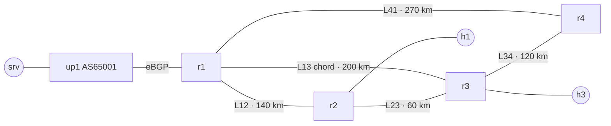

# Slice 1a: the IP core

Real FRR routers in containerlab: a **ring + one chord** so every link has an alternate path, **OSPF** as the underlay with **BFD** for fast failure detection, an **iBGP full mesh** inside AS 65000 and **eBGP** to an upstream (AS 65001). Every core link is shaped to a **scaled capacity** (100 Mbit/s = 100 Gbit/s at 1:1000) and gets its **real fibre propagation delay** (5 µs/km).

```
                 up1 (AS 65001, "Internet") ── srv 203.0.113.10
                  │ eBGP
        R1 ───L12 (140 km)─── R2 ── h1 100.64.2.10 (customer)
        │  ╲                  │
  L41 (270 km)  L13 (chord,   L23 (60 km)
        │      200 km) ╲      │
        R4 ───L34 (120 km)─── R3 ── h3 100.64.3.10 (customer)
```



(generated with `containerlab graph --mermaid`, labels added)

| | |
|---|---|
| Loopbacks | 10.0.0.1–4/32 (OSPF, BGP update-source) |
| Core links | 10.1.xy.0/30, OSPF point-to-point, cost 10, BFD 300 ms × 3 |
| BGP | iBGP full mesh (6 sessions), r1 = border router with `next-hop-self`; customers originated by r2/r3 |
| Shaping | `tc` per interface: `htb` 100 Mbit/s → `netem` fibre delay (later also the optical loss) |

Why the chord L13 is 200 km: in the optical layer its lightpath rides fibres F12 **and** F23, so it shares fate with L12 and L23 (an SRLG, used from Slice 1d on).

## Run it
```bash
sudo bash deploy.sh        # build host image, deploy, shape links, wait for BGP
sudo bash convergence.sh   # the 3 failure scenarios below
sudo bash traffic.sh       # demand matrix + per-link utilisation
sudo containerlab destroy -t core.clab.yml
```

## Results (laptop, 2 Nov 2026)

**Routing:** all OSPF adjacencies Full and BFD up on every core link; 4/4 BGP sessions on r1 Established ~7 s after deploy; the upstream learns both customer prefixes.

**Latency follows the fibre** (one-way delay = km × 5 µs, so the round trip can't be shorter than 2 × that):

| Path | Crosses | Floor (RTT) | Measured min RTT |
|---|---|---|---|
| h1 → srv | L12 (140 km) | 1.40 ms | 1.66 ms |
| h3 → srv | L13 (200 km) | 2.00 ms | 2.34 ms |
| h1 → h3 | L23 (60 km) | 0.60 ms | 0.77 ms |

**Failure of L12 while a constant 1000 pkt/s stream crosses it** (`convergence.sh`, 3 runs each). Traffic always moves to r2 → r3 → r1 (L23 + L13):

| Failure | What detects it | Outage (3 runs) |
|---|---|---|
| A. port down on r1 | the router sees its own interface die | **0.06 · 0.06 · 0.06 s** |
| B. silent fibre cut, BFD on | BFD: 3 missed packets × 300 ms (≤ 0.9 s) | **0.82 · 0.85 · 0.74 s** |
| C. silent fibre cut, BFD off | OSPF dead interval (40 s after the last hello) | **33.4 · 36.1 · 33.4 s** |

BFD turns a ~35 s outage into < 1 s for a fibre that goes dark while both interfaces stay up. That's the hard-cut case (fault F2), which OSPF + BFD handle without any automation. A *gray* failure (a degrading fibre that still passes hellos and BFD) is the case OSPF can't see, and that's what the rest of FiberTwin is for.

**Demand matrix** (`traffic.sh`, 20 s, UDP): each flow lands on the shortest OSPF path, the ring's other links stay idle as backups.

| Link | Flow | Measured | Utilisation |
|---|---|---|---|
| L12 r1 → r2 | srv → h1 (30 Mbit/s) | 29.3 Mbit/s | 29 % |
| L13 r1 → r3 | srv → h3 (40 Mbit/s) | 39.1 Mbit/s | 39 % |
| L23 r2 → r3 | h1 → h3 (20 Mbit/s) | 19.5 Mbit/s | 20 % |
| L41, L34 | (backup paths) | 0 | 0 % |

**RAM:** ~29 MiB per core router (OSPF + BGP + BFD), 22 MiB for the upstream, ~1–3 MiB per host: **~145 MiB for the whole core**.

## Lessons learnt while building it
- **Windows line endings break FRR silently.** Config files written on Windows had `\r\n`: FRR read `ospfd=yes\r`, didn't start the daemons and only said "ospfd is not running". Fix: LF endings (`.gitattributes` forces them).
- **A test must check its own precondition.** The first scenario C "measured" 0 s because traffic hadn't come back to L12 after scenario B. The script now refuses to run a scenario unless the probe path really uses the link under test.
- **A health check can match itself.** `pgrep -f "iperf3 -s ..."` found its own command line, so the script believed the server was running and never started it. `pgrep -x iperf3` matches the process name only.
- **ping hides long outages.** When replies stop, ping slows down its own sending, so "lost pings × interval" undercounts. A constant-rate UDP stream (iperf3, 1000 pkt/s) gives the true outage.
