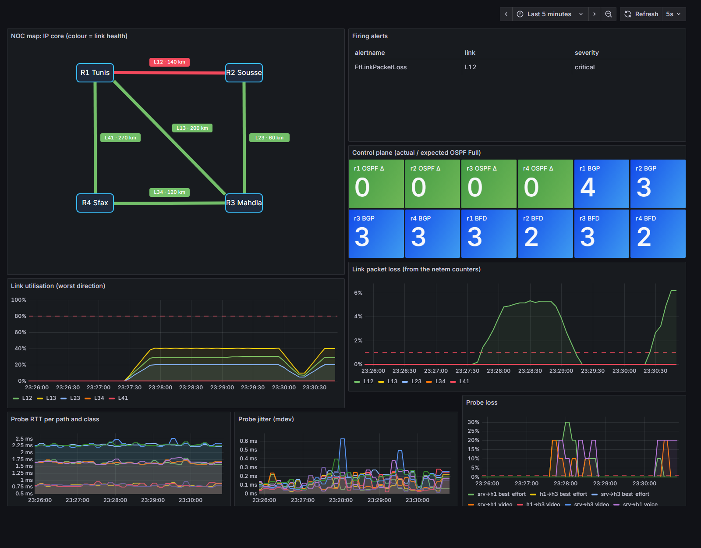

# Slice 1c: monitoring, alerting and the NOC map



*Above: 5 % packet loss injected on link L12. The map turns L12 red, exactly one alert fires, the loss and the traffic show in the graphs.*

```
twin (routers + hosts)
   │  lab-exporter (Python, Docker API): interface counters, netem drop counters,
   │                                    OSPF / BGP / BFD state, per-class probes
   ▼
Prometheus (5 s) ── recording rules: ft:link_loss_ratio, ft:link_util_ratio, ft:link_health
   │            └── alert rules ──► Alertmanager ──► Slack   (cause sent, symptoms inhibited)
   ▼
Grafana "FiberTwin NOC": map generated from sot/network.yaml + graphs
```

| What | How |
|---|---|
| **Link loss** | read from each link's own `netem` qdisc counters (sent / dropped), so it is the real data-plane loss on that link, not an estimate |
| **Utilisation** | interface `tx_bytes` rate ÷ shaped capacity (from the source of truth) |
| **Per-class probes** | 10 pings / 10 s per demand pair and class, marked with DSCP: voice EF, video AF41, best effort 0. RTT, jitter (mdev), loss. *No per-class queueing yet: the classes share one queue until the QoS study (Slice 4).* |
| **Control plane** | OSPF Full neighbours vs what the source of truth expects, BGP Established, BFD up |
| **Map** | Grafana Canvas, generated by `make_dashboard.py` from router positions in the SoT; each link coloured by `ft:link_health` (0 ok · 1 warning: loss > 0.1 % or utilisation > 80 % · 2 critical: loss > 1 % or link down) |

**Alerts**

| Alert | Type | Fires when |
|---|---|---|
| `FtLinkPacketLoss` | threshold | link loss > 1 % for 15 s |
| `FtLinkDown` | threshold | an interface of the link is down for 5 s |
| `FtLinkUtilisationHigh` | threshold | > 80 % of capacity for 30 s |
| `FtOspfAdjacencyMissing` | intent | fewer Full neighbours than the SoT expects, for 20 s |
| `FtPathLoss` | symptom | a probe path loses > 2 % for 30 s, **inhibited** when a link alert explains it |
| `FtLatencyRising` | **trend** | last-minute RTT > 1.5 × the previous 15 min and +1 ms |

## Checkpoint (2 Nov 2026, `checkpoint.sh`, traffic running)
5 % loss injected on L12, both ends:

| Step | Time after the change |
|---|---|
| loss visible in Prometheus | **8.2 s** |
| map shows L12 red | **8.3 s** |
| alert firing (after its 15 s "for") | **24.5 s** |
| alerts notified | **exactly 1** (`FtLinkPacketLoss` L12); the customer symptom `FtPathLoss srv→h1` also fired and was inhibited |
| Slack | 1 notification, 0 failures |
| back to green after removing the loss | 33.7 s |

The plan said "visible within one scrape" (5 s). Measured: 8 s, because loss is a rate over a 15 s window (3 scrapes) so one unlucky sample can't paint a link red. A first version with a 30 s window took 12 s. That trade-off (speed vs false alarms) is the job of the detection study in Slice 4.

## Lessons learnt
- **Secrets and container users:** Alertmanager runs as `nobody`, so it couldn't read the webhook file (mode 600, owned by my user) and every Slack notification failed. `up.sh` now installs a copy readable only by that group (`root:65534`, mode 0440) instead of loosening the original.
- **Optional regex groups after a lazy match match nothing:** the first exporter silently reported 0 % configured loss. Parsing now uses two plain patterns, tested on output captured from the lab.
- **WSL stops when idle**, and Docker restarts the routers *without* their containerlab links. The deployer now reconciles drift (missing link interfaces → redeploy), not just new commits.

## Run it
```bash
sudo FT_ROOT=/opt/fibertwin/repo bash monitoring/up.sh   # Grafana http://localhost:3000
sudo bash monitoring/checkpoint.sh                        # the measurement above
python monitoring/make_dashboard.py                       # regenerate the map after a topology change
```
RAM measured with the twin running: **~190 MiB** for the whole stack (Grafana 110, Prometheus 35, exporter 31, Alertmanager 17); compose limits 256 / 384 / 128 / 64 MiB.
