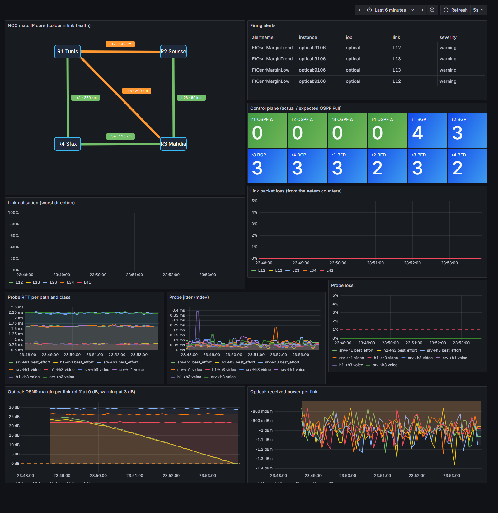

# Slice 1d: the optical layer (modelled L0)



*Above: fibre F12 is degrading. Its two IP links (L12, and the chord L13, whose lightpath also rides F12) turn orange and raise early-warning alerts **while packet loss is still 0 %**. The other links are untouched.*

## What runs
`optics/model.py` is plan §6.1, formula by formula. `optics/agent.py` (container `optical`) recomputes it every 5 s with the current faults, **applies the resulting packet loss to both ends of every IP link riding the fibre with `tc netem`**, and publishes noisy optical telemetry (OSNR ± 0.15 dB, power ± 0.1 dB) to Prometheus.

```
span losses (SoT: length, spans, α) ──► OSNR per span ──► 1/OSNR_tot = Σ 1/OSNR_i ──► Q ──► BER
   ──► RS(255,239) codeword failure ──► PLR (1500 B ≈ 7 codewords) ──► netem loss on the real links
```

| Check against the plan's table (`tests/test_optics.py`) | Plan | Model |
|---|---|---|
| pre-FEC BER 10⁻⁴ | ≈ 10⁻¹¹ | 8.6·10⁻¹² |
| pre-FEC BER 10⁻³ | ≈ 0.2 % | 0.17 % |
| pre-FEC BER 3·10⁻³ | ≈ 70 % | 69.5 % |

Required OSNR for PLR = 10⁻⁶ (the "margin = 0" line): **11.5 dB** (with the 2 dB implementation penalty). As built, the links have **22–29 dB** of margin (short metro spans).

## Faults (HTTP API on :8081)
| Fault | Call | Physical meaning | Signature |
|---|---|---|---|
| **L1** gray failure | `POST /fault/ramp {"fibre":"F12","span":0,"to_db":32,"db_per_min":6}` | loss growing inside an amplified span | OSNR falls on **every** lightpath of the fibre (SRLG); received power unchanged |
| **L1** step | `POST /fault/span {...,"extra_db":X}` | same, instantly | same |
| **L3** receiver | `POST /fault/rx {"link":"L23","extra_db":X}` | dirty connector after the last amplifier | received power falls on **one** link, OSNR only a little (pre-amp noise) |
| repair | `DELETE /faults` | | |

## Checkpoint (2 Nov 2026, `optics/checkpoint.sh`, data in `results/1d-ramp.csv`)
Gray failure: loss inside span 0 of F12 ramped 0 → 32 dB at 6 dB/min (time-compressed), held 40 s, repaired.

| t | Injected loss | L12 margin | Event |
|---|---|---|---|
| **84 s** | 8.1 dB | 19.0 dB | **`FtOsnrMarginTrend` L12**: at this slope, the cliff is < 10 min away |
| 94 s | 9.1 dB | 18.0 dB | `FtOsnrMarginTrend` L13: same fibre |
| 270–276 s | 26.6–27.1 dB | 1.0 → 0.2 dB | `FtOsnrMarginLow` on L13, L12 |
| **302 s** | 29.6 dB | −2.1 dB | **first measured packet loss**, on L12 and L13 only; BFD and OSPF drop the adjacency on r1 |
| 317–322 s | | | `FtLinkPacketLoss`, `FtOspfAdjacencyMissing` |
| repair + 40 s | 0 | | all alerts resolved, OSPF/BFD back |

- **Early warning 218 s before the first lost packet** (here 21.5 dB of degradation still to go).
- **SRLG on the real data plane:** maximum loss measured on L23, L34, L41 during the whole run: **0**.
- **The cliff:** from margin +0.5 dB (PLR 4·10⁻¹⁰) to −1.5 dB (PLR 67 %) is 2 dB of extra loss. Past it, BFD sees 3 lost packets in a row and tears the adjacency down: OSPF then reroutes *after* the damage. That's the gap the golden path (1e) closes by draining on the trend.

**Limits, stated:** the degradation rate is time-compressed (6 dB/min), so the 10-minute trend horizon is tuned for the demo; real fibres degrade over hours or days, and choosing the horizon and threshold is the job of the detection study (Slice 4). The model is first-order (ASE-limited, NRZ-OOK, no nonlinearities, dispersion or PMD), one loss rate per link, and the data come from my own model: validation on real equipment is future work. The honesty rule holds: alerts use only the noisy `ft_optical_*` telemetry; the injected fault is exported as `ft_truth_*` for evaluation only.

## Lessons learnt
- **"Restart" is not "reload".** `docker compose restart` failed silently (missing environment variables), so Prometheus kept its old config and never scraped the new agent: the first run of this checkpoint recorded no optical data at all. `monitoring/up.sh` now reloads Prometheus through its lifecycle API.
- **Label matching in PromQL drops series silently.** Adding `ft_optical_margin_db` (labels `link, job, instance`) to a sum of `{link}`-only terms would have removed links from the map. Every term of `ft:link_health` is now reduced with `max by (link)`.
- **The plan's "OSNR unchanged" for a receiver fault is first-order.** The receiver pre-amplifier adds noise, so 10 dB of extra loss costs L23 about 2 dB of OSNR. The diagnostic signature (power falls a lot, OSNR a little, one link only) still holds and is what the test checks.

**Still mine to write:** `docs/derivations/q-factor.md` (the derivation of the Q formula and its assumptions, plan §6.1 step 2).
